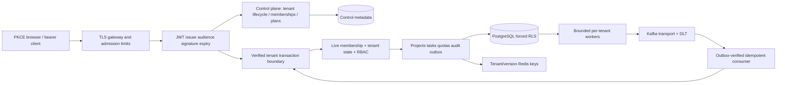
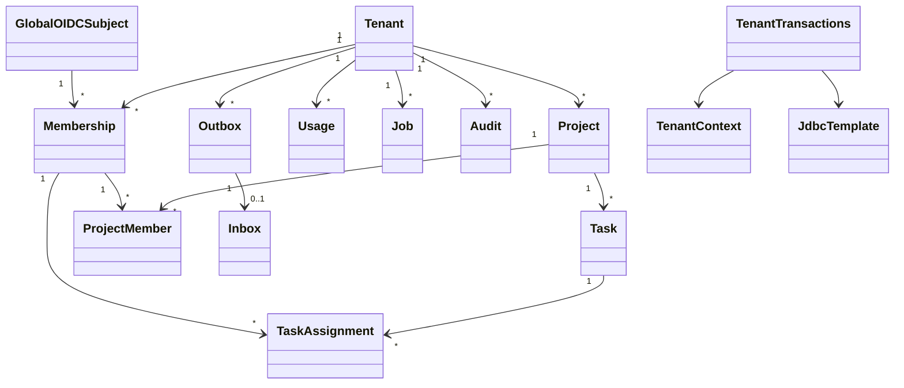

# Requirements and architecture

Execution update: [current durable workflows and controls](implementation-update.md) supersedes the initial
worker/cache/billing limitations below. Current deployment gaps are tracked in [limitations](limitations.md).

## Requirements and threat model

Provide global OIDC identity, multiple organization memberships, tenant registration/provisioning, role administration,
tenant switching, projects/tasks/assignments, searchable paginated lists, dashboards, exports, subscriptions,
entitlements, API/project/seat/job quotas, durable audit, controlled lifecycle and background processing. Require every
tenant data access to be authenticated and authorized; absence of tenant context fails closed. Unauthorized tenant
selectors return 403; authorized context with another tenant's object returns 404. SQL predicates are not the
authoritative isolation boundary.

Adversaries include authenticated malicious members, guessed UUIDs, forged selectors, stale tokens, malformed broker
messages, accidental unscoped business SQL, connection reuse and asynchronous misrouting. Assume trusted IdP issuer,
uncompromised host/database credentials and reviewed migration code. RLS does **not** protect against arbitrary SQL
execution with the ability to call `set_config`, compromised owners/superusers, malicious code deliberately selecting
another tenant, side channels in shared infrastructure or compromised platform administration. Control-plane queries are
explicitly trusted and scoped in reviewed code; their tables are not ordinary business repositories.

Acceptance gates: compile on JDK21, real PostgreSQL migration success, runtime NOSUPERUSER/NOBYPASSRLS, forced policies
on all ten data-plane tables, per-transaction initialization on the same bound connection, no cross-tenant
CRUD/joins/bulk/native/export/cache/message access, immediate revalidation at boundaries, concurrency-safe quotas,
controlled admin flow, reproducible two-tenant HTTP demo. Additional production gates remain in limitations.md.

## Decisions

| Model               | Benefits                                                                                         | Costs and risks                                                                                     | Decision                                            |
|---------------------|--------------------------------------------------------------------------------------------------|-----------------------------------------------------------------------------------------------------|-----------------------------------------------------|
| Shared schema + RLS | Efficient pools/migrations; composite tenant indexes; database protection for omitted predicates | Shared CPU/I/O; owner privileges; policy drift; large table/index growth                            | Initial model                                       |
| Schema per tenant   | Namespace isolation; separate logical objects                                                    | 100k schemas/catalog growth; migration fanout; unsafe search_path routing; shared server contention | Avoid initially                                     |
| DB per tenant       | Restore/residency/fault boundary; separate encryption/placement                                  | Pool explosion, fleet migrations, higher cost and idle capacity                                     | Enterprise extension                                |
| Hybrid              | Shared control plane plus dedicated hot/compliance tenants                                       | Routing epochs, multiple operational modes, migration fencing                                       | Documented extension, no generic router implemented |

Modular monolith keeps transaction, outbox, quotas and lifecycle correctness in one deployment. Domain services become
justified by independent ownership, scaling or compliance boundaries; they add partial failures, revocation propagation
and operational costs. A hybrid shared control plane with regional data planes is the long-term direction, not a claim
about this executable.

JDBC avoids ORM flush/connection ambiguity. Spring TransactionTemplate uses REQUIRES_NEW at each explicit tenant
boundary, initializes `set_config(...,true)`, then performs every query via the same JdbcTemplate/DataSource. No
ThreadLocal or inherited authorization state. Reads use a shared transaction advisory fence and read-only business
transactions; mutations/control changes acquire the exclusive fence. Database triggers enforce the control fence and
cache epochs. Metering uses independent short transactions or conservative durable request budgets;
see [throughput hardening](throughput-hardening.md). Unrelated tenants remain subject to shared pool/server/WAL
saturation. RBAC is tenant scoped; all non-viewers may write projects/tasks, admins manage configuration/invitations,
only owners change plans/delete tenants, and PLATFORM_ADMIN alone executes platform actions. No per-project private ACL
is claimed.

## Overall/control and data planes

## Domain and low-level design

Global identity is `(issuer, subject)` within one configured issuer; only subject is stored because the deployment
accepts exactly one issuer. Cross-tenant relationships use `(tenant_id,id)` FKs. Membership identity is
`(tenant_id,subject)`. IDs deliberately may overlap across tenants. Unique project names are tenant scoped. Indexes lead
with tenant ID and selective status/project keys; global control lookups have subject indexes. Benchmark actual EXPLAIN
plans and table bloat before partitioning. Partition by region/shard and bounded hash buckets, not one partition per
small tenant. No distributed joins or generic datasource abstraction exist.
