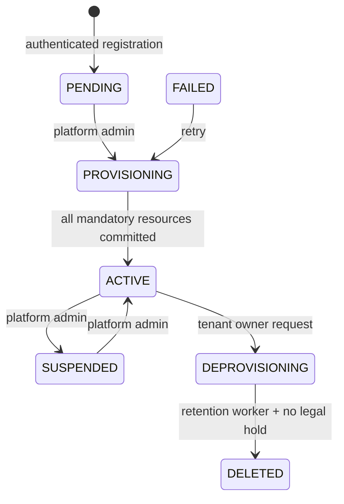
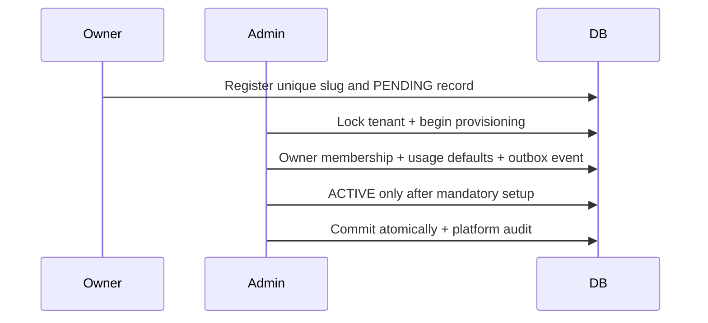

# Provisioning and lifecycle

Execution update: [current durable workflows and controls](implementation-update.md) supersedes the initial
worker/cache/billing limitations below. Current deployment gaps are tracked in [limitations](limitations.md).





Registration retries on the same slug return the existing record only to the original owner; another owner gets a
non-disclosing conflict. Provisioning is serialized and atomic because the initial model requires no external per-tenant
resources. A crash rolls back to PENDING/FAILED; retry does not duplicate memberships/usage. PROVISIONING and FAILED are
reserved recoverable states; the initial transaction does not expose an intermediate PROVISIONING commit or
automatically persist FAILED on transaction rollback. External storage/dedicated DB provisioning will need a durable
saga/step journal and compensation.

```mermaid
sequenceDiagram
 participant AdminOwner
 participant Boundary
 participant Worker
 participant DB
 AdminOwner->>DB: Suspend via explicit platform operation
 DB->>DB: Wait for prior tenant lock, commit SUSPENDED
 Boundary->>DB: Fresh state lock after suspension
 DB-->>Boundary: Deny
 AdminOwner->>DB: Owner deletion request + 30-day retention
 Worker->>DB: Recheck DEPROVISIONING / deadline / legal hold
 Worker->>DB: Delete business data, jobs, events; disable memberships
 Worker->>DB: Tombstone DELETED, retain audit and identity metadata
```

Deletion immediately denies new tenant boundaries and cancels jobs. Existing locked transactions finish before
suspension/deletion takes effect; there is no rollback of already committed responses. The purge is idempotent and runs
at most five tenants per scan; failures roll back and retry at the next scan. Audit records and control membership
subject metadata remain for investigation and FK integrity; this is **not a complete GDPR erasure implementation**.
Redis has a 30-second TTL and no supported read path for suspended/deleted tenants; physical eviction is eventual. Legal
holds require an authorized DBA/control operation; no UI is provided. Immutable backups follow storage expiry, not
immediate per-tenant erasure. Large purges need bounded chunking and a durable cursor before production.
