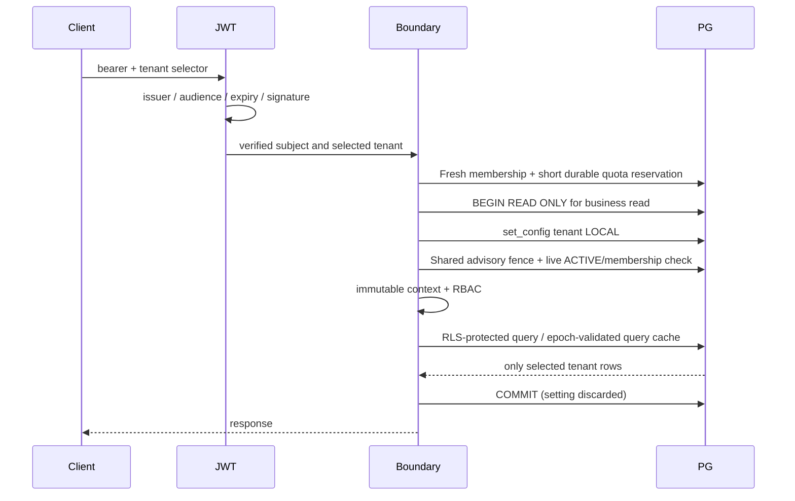
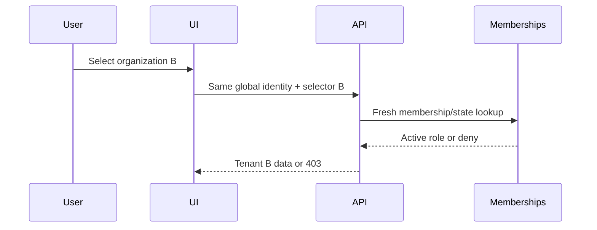
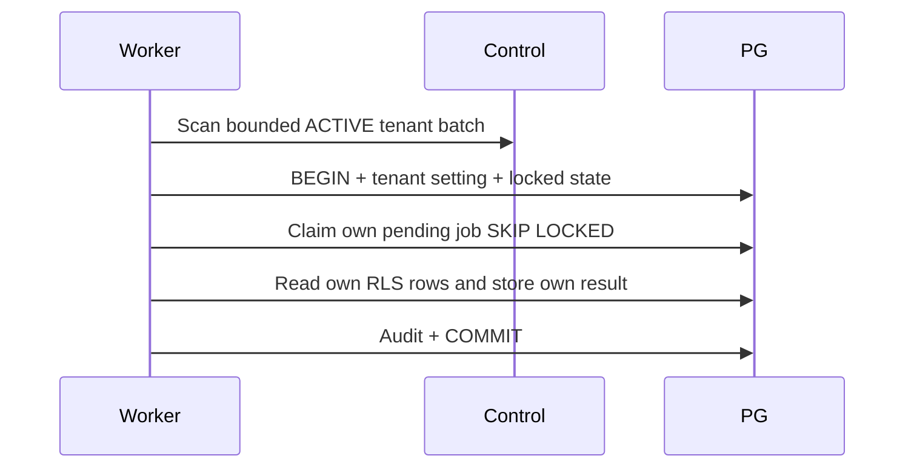
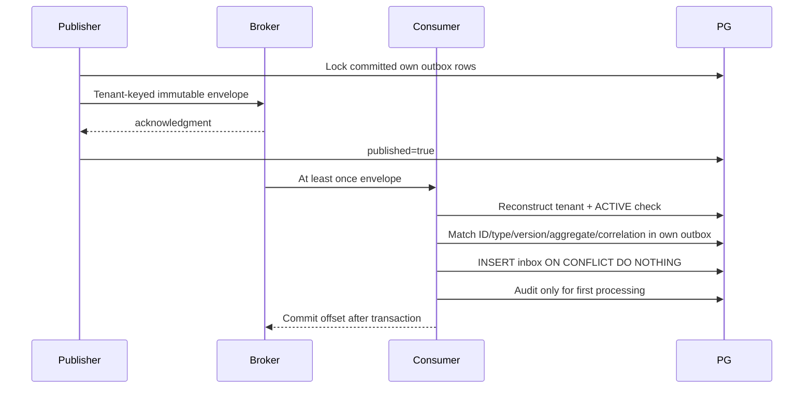

# Request and execution boundaries

Execution update: [current durable workflows and controls](implementation-update.md) supersedes the initial
worker/cache/billing limitations below. Current deployment gaps are tracked in [limitations](limitations.md).

Selectors (subdomain, path, header, organization claim) name a requested tenant; none proves membership. The baseline
uses the path ID for tenant management and `X-Tenant-ID` for business APIs. The signed JWT supplies identity; database
membership and ACTIVE state authorize selection. If a JWT contains `tenant_id`, it must agree with selection. URL IDs
govern tenant management; header values cannot override them.

Immutable TenantContext is passed as a method argument. Receiving a context object is never the HTTP authentication
mechanism. Constructors/boundary helpers are package scoped and trusted application code. Async jobs carry tenant ID in
durable rows; consumers reconstruct only after matching a committed outbox record. Never use CompletableFuture common
pools or implicit security context as authorization. Virtual threads change execution resource costs, not these rules.
There are no application ThreadLocals to clear.

Nested calls use REQUIRES_NEW: outer connection suspends, inner obtains a fresh connection, initializes its own tenant
setting, then outer resumes with its original setting. Nested boundaries consume additional pool capacity; do not
recursively invoke arbitrary nesting. Quota reservation completes before the business transaction begins; the ordinary
read path never holds one JDBC connection while requesting another. Ordinary mutations acquire an exclusive tenant
advisory fence; reads acquire a shared fence. Control-table triggers reject concurrent unfenced metadata changes,
protecting suspension/member revocation without row writes for every read. Supported control flows acquire the fence
before locking rows. Lock-key hash collisions cause false contention only; RLS still compares exact UUIDs. Missing/empty
GUC yields NULL UUID and no rows; malformed UUID causes SQL failure. Business GET transactions are read-only. API quota
reservation uses a separate short write transaction. Accepted authorized attempts count even if subsequent business work
returns404/rolls back. Optional durable request budgets reserve at most sixteen credits, with a fresh database
membership/state check inside the business transaction before every locally consumed credit; they cache no
authorization. Read the [quota protocol](throughput-hardening.md) before enabling this optimization. No JPA flush or
replica data path exists.

The broker is not an authentication authority. Only this application's committed outbox envelopes are accepted.
Production must additionally use Kafka TLS/SASL and producer/topic ACLs. Consumer retries twice then publishes DLT;
failure to publish DLT prevents successful recovery. Local outbox attempts cap at five; operator inspection/replay is
required afterward. Suspended tenants retain validated inbox records without projecting business changes; activation
drains them idempotently. Deprovisioned/deleted tenants remain fenced. No cross-service arbitrary event execution is
supported.
