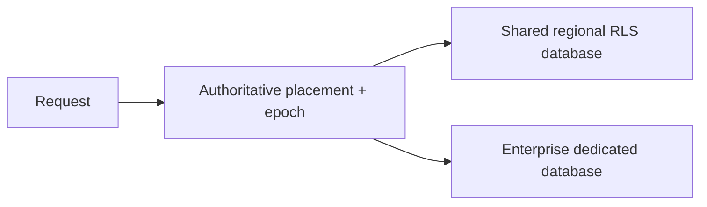

# Shared to dedicated migration runbook (design, not implemented)

1. Approve residency, downtime window, backup/rollback and scope. Provision a target with identical schema/policies and
   distinct least-privilege runtime role. Run role/RLS gates.
2. Create migration record/epoch and source fence. Freeze routing topology. Initial simple procedure suspends tenant and
   drains transactions/jobs before copy; this trades downtime for simpler consistency.
3. Export all tenant-owned tables in one consistent snapshot including relationships, usage, jobs, audit and event
   deduplication metadata; exclude other tenant rows by RLS and explicit predicates. Copy required control/membership
   metadata via audited restricted flow.
4. Restore using tenant-scoped transactions. Verify row counts, canonical checksums, FK consistency, audit ranges, quota
   state and outbox/inbox reconciliation. Never re-run external side effects solely because rows were copied.
5. Advance authoritative routing epoch with compare-and-swap, invalidate routing/cache, and fence source writes.
   Uncached placement lookup and epoch rejection prevent dual writers. Resume only after verification on destination.
6. Retain source encrypted/read-only for an agreed safety period. Rollback while no destination writes occurred is
   routing reversal; after writes, reverse replication/reconciliation is required. Never switch blindly to a stale
   source.
7. Erase old live rows only after restore rehearsal and retention approval. Backups expire independently.

For lower downtime: consistent initial snapshot + CDC with source LSN, copy/delta reconciliation, short final write
fence and LSN catch-up. A one-time copy while writes continue is insufficient. Per-tenant restore should occur in an
isolated scratch database, validate, then re-import one tenant under an epoch/write fence; never restore the entire
shared primary over other tenants.
